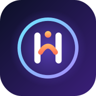
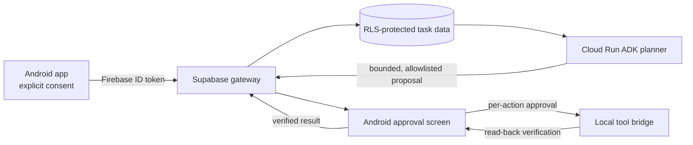

<h1 align="center">✨ HOPE AI — Your Voice Assistant</h1>

<p align="center">
  <strong>Talk to HOPE, get help with everyday tasks, manage notifications, and handle calls — all from one Android app.</strong>
</p>

<p align="center">
  
  
  
</p>

<p align="center">
  
</p>

<p align="center">
  <a href="./CHANGELOG.md">Changelog</a> ·
  <a href="./docs/architecture/cloud-agent-implementation.md">Cloud Agent build guide</a> ·
  <a href="./docs/architecture/cloud-agent-gateway.md">Cloud Agent architecture</a> ·
  <a href="./SUPABASE_SETUP.md">Supabase setup</a> ·
  <a href="./docs/README.md">All documentation</a> ·
  <a href="https://github.com/yashpawar9274/HOPE-V3/releases">GitHub releases</a>
</p>

## 👋 About HOPE AI

HOPE is an Android voice assistant with conversational voice features, phone and contact tools, notification intelligence, and on-screen task automation. It combines Gemini Live and Android voice capabilities with system integrations that work when the required permissions and services are enabled.

## 🚀 Get started

1. 📥 **Install HOPE:** download a release-signed APK from [GitHub Releases](https://github.com/yashpawar9274/HOPE-V3/releases) when one is attached. If no APK asset is available, build the debug APK using the steps below.
2. 🔐 **Sign in:** use the Firebase sign-in configured for this app. Cloud features are unavailable until their backend is deployed.
3. 🛡️ **Grant access deliberately:** allow only the Android permissions or system services needed for the features you choose.
4. 🎛️ **Choose features:** enable optional experiences separately in HOPE settings. Cloud Memory, Cloud Agent, clipboard analysis, standby listening, and other integrations are opt-in.

## 🧭 Cloud Agent at a glance

The Cloud Agent is implemented in source across three phases. It is **not production-deployed**: its Supabase migrations and gateway function, and its Cloud Run worker, still need review and deployment before tasks can run end-to-end.



See the [implementation process](./docs/architecture/cloud-agent-implementation.md), [security and architecture details](./docs/architecture/cloud-agent-gateway.md), and [deployment instructions](./SUPABASE_SETUP.md#6-cloud-agent-gateway-and-runtime-phases-1-3).

## 🌟 App features

### 🗣️ Multi-speaker recognition — new in 1.9.6
- Add up to 12 consenting speaker profiles with a preferred name, form of address, and language. Enrollment asks the speaker to explicitly consent and record three prompted samples in a quiet place; retraining and deletion require Android device authentication.
- Reuses the bundled on-device Vosk/Kaldi speaker x-vector model already used by HOPE's owner voice feature. Raw enrollment audio is held in memory only and cleared after each embedding is extracted. The 128-dimensional voice embeddings and profile labels are stored in an AES-GCM encrypted private record with a key held by Android Keystore.
- Enable personalized addressing separately, adjust the cosine-distance threshold, and use UNKNOWN for low-confidence or ambiguous matches. Unknown voices are instructed to receive neutral forms of address.
- Speaker recognition is probabilistic, may be affected by noise, language, device, distance, or replay, and is **not** authentication. Never use it to authorize financial, security, or device-unlock actions. Target-device accuracy, false-accept/false-reject behavior, and replay resistance have not been validated.
- When personalization is enabled, only the selected preferred address and language are sent as response context to the configured AI service; the profile embeddings remain local. The existing HOPE character voice and TTS configuration are unchanged. No new Android permission is required beyond existing microphone access.
- **Setup:** open **Settings → Speaker Profiles**, set a secure Android screen lock (required to manage profiles), add each consenting speaker, review the privacy notice, check consent, and record all three prompts in a quiet place. Then enable personalized addressing and adjust the threshold if needed. The Vosk speaker model is bundled; enrollment and embeddings do not need a model download or internet connection. Microphone permission is required to enroll and for live matching.

### 🔐 HOPE Security Manager — new in 1.9.5
- Protect HOPE's own screens with a separate PIN, 3×3 pattern, or alphanumeric password; credential changes require the existing app credential.
- Store a salted PBKDF2-HMAC-SHA256 verifier (600,000 iterations) inside an AES-GCM-encrypted local record whose key is held by Android Keystore. Plaintext credentials are never persisted or logged.
- Configure automatic relocking immediately or after 1, 5, or 15 minutes in the background. Cold process starts require authentication again. Locked app windows use Android's secure-window flag to prevent screenshots and recents previews.
- Optionally enable strong biometric unlock through Android BiometricPrompt. Recovery asks Android to authenticate the device owner, then resets only HOPE's app lock; HOPE never sees or stores the phone's PIN, pattern, or password.
- Say “Hey HOPE, unlock my phone” to request Android's supported keyguard dismissal flow. Android controls whether its system screen appears and whether authentication succeeds. HOPE requires a visible app Activity for this voice action; otherwise unlock the phone manually and reopen HOPE.
- The app lock does not replace, modify, or bypass Android's device lock. Emergency incoming-call UI remains available.

### 🎙️ Voice clipboard and Hey HOPE standby — new in 1.9.4
- Opt in separately to voice clipboard actions and on-device Hey HOPE standby from Hands-Free settings; both are off by default.
- Say “HOPE, copy the selected text”, “HOPE, copy this link”, “HOPE, paste here”, or “HOPE, select all”. Clipboard actions operate on supported focused or selected content through Android Accessibility and report when the action cannot be verified.
- Explicit HTTP(S) links are validated and kept intact. Password fields and content recognized as passwords, one-time codes, or payment details are blocked; sensitive-content checks are best-effort, not a guarantee.
- No clipboard history is stored. Explicit dictated-text copying uses Android ClipboardManager directly. Selection, link extraction, paste, and select-all require HOPE Accessibility to be enabled separately in Android Settings.
- “HOPE, activate standby mode” or “HOPE, go to standby” enters standby only after HOPE finishes its current response. “Hey HOPE” is checked locally by the bundled Vosk recognizer; ambient audio is not sent to Gemini or retained by this wake detector.
- Standby requires microphone and notification permission, a visible-app start, and an ongoing Android foreground-service notification. Background start, battery, microphone privacy, and screen-lock behavior can vary by Android version and device; use the in-app Stop listening control to disable it immediately.

### 📋 Smart Clipboard Intelligence
- Clipboard access is on-demand only: HOPE does not monitor or poll clipboard changes. Ask “What did I copy?”, “Explain my copied text”, “Iska reply kya dena chahiye?”, “Translate my copied content”, or “Copied image explain karo”, or tap **Check Clipboard**.
- Text and image analysis have separate settings. Password-, OTP-, token-, and payment-like text is blocked by local best-effort checks; do not request analysis of images containing credentials or payment details. Suggested replies are never sent to other apps.
- Android 10+ can block clipboard access while HOPE is in the background, and a foreground service does not bypass this restriction. HOPE explains the limitation and offers a notification that opens the visible clipboard screen; if notifications are unavailable, open HOPE and repeat the request.
- Spoken responses use HOPE's shared speech engine. Clipboard history is off by default; enabling it stores a bounded history in encrypted preferences, and turning it off clears that history.
- Clipboard settings and the entry point are under **Settings → AI Features & Cloud Identity**. The clipboard screen uses the unchanged original `orb.html` animation.

### ☁️ Supabase foundation
- Supabase is used as the backend for optional long-term conversation memory; users do not create a separate Supabase account. HOPE reuses the existing Firebase sign-in and scopes transcript access through Firebase third-party JWT verification and owner-only RLS.
- When enabled with consent in **Settings → Neural Memory Bank**, HOPE backs up up to 100 locally retained turns already associated with the current Firebase account once, then stores completed text chats and regular voice transcripts in Supabase and asks Mem0 to extract searchable memories. Older untagged history is not copied. Clipboard and automation-only turns are excluded; audio is not stored. Cloud memory is off by default and includes controls to pause and clear cloud data.
- The project URL/publishable key are public client values. Firebase project ID and `MEM0_API_KEY` belong in Supabase Function Secrets; the service-role key is used only inside the Edge Function and never in Android. The memory function verifies Firebase ID tokens and scopes database operations to the verified Firebase UID. Deploy both database migrations and the Edge Function, then test with two Firebase accounts. See [SUPABASE_SETUP.md](./SUPABASE_SETUP.md).
- Existing Gemini requests remain client-side to preserve current functionality. The optional Edge text gateway is not yet a replacement; client-held Gemini keys remain extractable and Gemini Live has not been proxied.

### 🤖 Cloud Agent Tasks — new in 2.0.0
- Submit an objective through the opt-in Cloud Agent screen, review task state and ordered events, and pause, resume, or cancel tasks.
- A Kotlin/JVM Google ADK worker produces a bounded plan; it has no callable device tools. Android independently validates every proposed tool call.
- The current local bridge is restricted to device-context reads and lowering screen brightness. Every proposal requires explicit approval; brightness changes require Android's special settings access and read-back verification.
- Consent is separate from Cloud Memory consent. Objectives are sent to Gemini only after Cloud Agent consent; device context is sent only after approval of that specific request.
- **Deployment status:** the gateway, migrations `202611120003` and `202611120004`, and Cloud Run worker are not deployed. Cloud tasks will not progress end-to-end until deployment and server-side configuration are completed.
- The worker does not retrieve Mem0 memory and its ADK session state is in-memory only. See the [detailed implementation guide](./docs/architecture/cloud-agent-implementation.md).

### 🎙️ Voice assistant
- Talk with HOPE using the app’s voice controls and supported live voice experience.
- Configure the assistant persona and available voice settings.
- Use HOPE as Android’s default digital assistant after selecting it through Android Settings.
- Voice features depend on device support, permissions, network access, and Gemini configuration.

### 📱 HOPE Phone
- Use the Dial Pad, Contacts, and Recent Calls screens.
- Access device contacts and call history when the required Android permissions are granted.
- Place cellular calls through Android Telecom.
- Use supported in-call controls, including mute, speaker, keypad, and hold.
- See call screens update from Android Telecom’s actual call state.
- Incoming-call voice confirmation is optional. HOPE does not record or transcribe cellular call audio.

### 📞 Redesigned call screens — new in 1.9.3
- Incoming calls show the HOPE ORB above the caller name and number, with prominent Answer and Decline controls.
- Outgoing and active call screens keep the ORB centered, show the real Telecom call state, and retain supported in-call controls.
- Answer/Decline and in-call controls stay in a bottom-pinned control area instead of scrolling offscreen; outgoing calls show Mute and supported Speaker controls while connecting.
- The call screen uses a responsive dark layout and text-first controls without emoji icons.
- Caller details and call state come from Android Telecom; sample details are used only in the visual preview.

### ✨ HOPE Call ORB — new in 1.9.2
- Updated call screens with a particle-style HOPE ORB.
- ORB status follows incoming, connecting, active, held, and ended call states.
- Listening status is shown when HOPE’s incoming-call voice recognition is actually active.
- Three.js is bundled in the app for offline rendering; a visual fallback is available when WebGL cannot initialize.

### 🔔 Notification Inbox and announcements
- View notifications Android has actually delivered to HOPE, with inbox history and read status.
- Configure notification monitoring and announcements per app.
- Use the shared HOPE announcement voice path, with available controls for announcement behavior.
- Notification access must be granted in Android Settings. Supported content depends on notifications received from other apps.

### 💬 Auto-Reply
- Automatic sending is off until the user explicitly enables the relevant settings and rules.
- Replies are limited to selected apps and supported Android inline-reply actions.
- Unsupported reply actions, disabled permissions/settings, and safety exclusions prevent sending.
- Reply previews and spoken replies are separate from sending a message.
- Ask HOPE by text or voice to start, stop, or check WhatsApp auto-reply; starting checks Notification Access, notification monitoring, an enabled WhatsApp `AUTHORIZED_AUTO_REPLY` rule, and AI configuration before enabling WhatsApp monitoring.
- Message replies use HOPE's configured AI router when AI replies are enabled, or the configured authorized-rule/template reply otherwise. Messages are screened for sensitive content and hashed fingerprints prevent recent duplicate submissions.
- Android must provide a supported notification `RemoteInput` action. HOPE reports the action submission, not confirmed recipient delivery; WhatsApp does not expose a universal personal-account send API to this app.
- Notification callbacks may run with the screen off, but Android/OEM process limits can delay or stop processing. Pending replies are in-process work and are not guaranteed to survive process termination.

### 📸 Voice screenshot
- Ask HOPE to take a screenshot, including **“screenshot le lo”**.
- Screenshot capture depends on Android version and the required Accessibility or user-approved Screen Share access.
- Screenshots are saved locally; the feature does not send them to Gemini.

### 🤖 On-screen tasks
- HOPE can assist with supported app and screen tasks using Android Accessibility and visual assistance features.
- Automation depends on the target app exposing usable screen controls and the required system access being enabled.
- HOPE may stop or ask for help when an action cannot be verified.

## 🔐 Permissions and privacy

HOPE’s system integrations require the relevant Android permissions or user-enabled services. This may include microphone, Contacts, Phone, Notification Access, Accessibility, overlay, and Screen Share access, depending on the feature used. Hey HOPE standby, voice clipboard, Smart Clipboard, image analysis, and speaker-personalized addressing are separate opt-ins. Smart Clipboard reads clipboard content only after an explicit voice request or user action; text and image analysis have independent settings. Sensitive-text checks are best-effort, and images should not contain credentials or payment details. Android 10+ background clipboard restrictions are respected; a foreground service does not bypass them. Clipboard history is off by default and is stored only when explicitly enabled using encrypted preferences. Standby and speaker embeddings use bundled Vosk models on-device; the active conversation still uses the configured HOPE/Gemini voice service. With personalized addressing enabled, the selected profile's preferred address and language are sent to that configured AI service as context. Voice embeddings are not uploaded. Explicit dictated-text copying uses Android ClipboardManager. Clipboard operations that interact with other apps require the user to enable HOPE Accessibility and separately opt in to voice clipboard in the app. HOPE does not retain enrollment recordings.

The HOPE app-lock verifier and encrypted security settings remain on-device. App-lock credentials are entered only in the security screen and are not included in AI prompts, notification content, analytics, or cloud requests. Notification history and screenshots are handled on-device where supported. AI features that use Gemini require network access and may send the content needed to answer your request to the configured Gemini service. Review the in-app settings and Android permission prompts before enabling integrations.

## 🆕 Changes in version 2.0.0

- Added Cloud Agent Phases 1–3: consent-gated task gateway, Kotlin/JVM ADK planning worker, Android task review screen, and a confirmation-based local tool bridge.
- Added database-enforced task ownership, quotas, idempotency, ordered events, expiring tool requests, atomic plan publication, and consent revocation handling.
- Restricted device actions to context reads and lowering brightness; actions require explicit approval, platform permission checks, and read-back verification.
- Updated the app version to **2.0.0** (version code **153**).
- Cloud Agent backend components remain source-only and must be deployed before tasks can execute end-to-end. See [CHANGELOG.md](./CHANGELOG.md) for the full release history and validation status.

## ✅ Verification

- Debug APK build: **passed** with `.\gradlew.bat assembleDebug`
- Unit tests: **passed** with `.\gradlew.bat testDebugUnitTest`
- Debug APK output: `app/build/outputs/apk/debug/app-debug.apk`
- Cloud Agent worker tests and distribution build: **passed** with `.\gradlew.bat -p cloud-agent-runtime test installDist`
- Supabase Edge Function checks and policy tests: **passed** with `deno check` and `deno test`
- Cloud Agent migrations and worker deployment: **not performed**
- Device tests for WhatsApp notification formats, inline reply availability and acceptance, screen-off processing, process recreation, Android Keystore persistence, biometrics/recovery UI, app lifecycle relocking, OS keyguard requests, clipboard interoperability, wake false activations, and Android/OEM background limits: **not performed**

## 📲 Install

Install a release-signed APK from [GitHub Releases](https://github.com/yashpawar9274/HOPE-V3/releases) when one is attached. Otherwise, build a debug APK locally:

```powershell
.\gradlew.bat testDebugUnitTest
.\gradlew.bat assembleDebug
```

The debug APK is written to `app\build\outputs\apk\debug\app-debug.apk`. It is not a release-signed APK. Install on Android 8.0 (API 26) or later; Android may ask you to allow installation from the source used to download the APK.

## 🏷️ Topics

`hope-ai` · `android` · `voice-assistant` · `phone-dialer` · `notifications` · `auto-reply` · `accessibility` · `security-manager` · `speaker-recognition` · `cloud-agent` · `v2.0.0`

---

<p align="center">
  Made for Android with Kotlin and HOPE.
</p>
