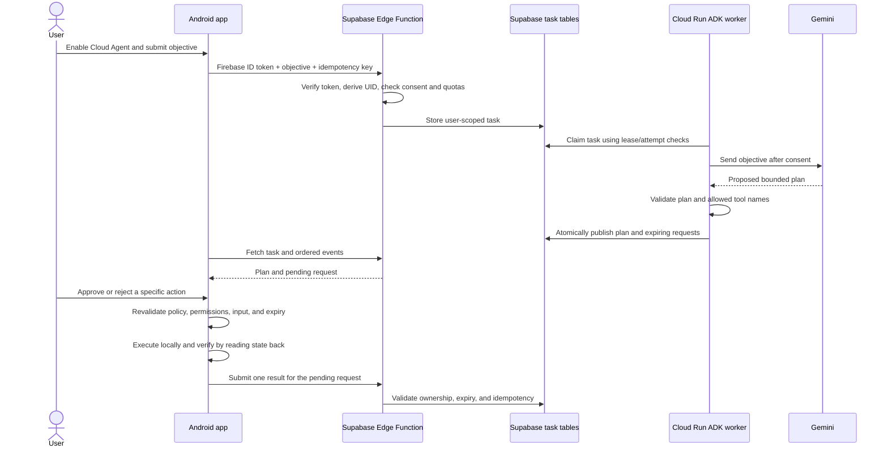

# HOPE Cloud Agent implementation guide

This guide explains how Cloud Agent Phases 1–3 were implemented and how to validate and deploy them safely. The Android app, Supabase function/migrations, and worker are implemented in source, but the Cloud Agent backend is **not deployed**. Do not treat a successful local build as proof that production tasks can run.

## Goals and boundaries

Cloud Agent accepts an explicit user objective, asks a cloud planner for a bounded plan, and returns device-action proposals to Android for review. The planner does not receive callable device tools. Android owns the final policy check, confirmation, execution, and verification.

The feature is separately opt-in and off by default. Firebase identity establishes the user; Cloud Agent consent is not inherited from Cloud Memory consent. There is no Mem0 retrieval in this implementation.

## End-to-end flow



## Phase 1 — task control plane

### Android client and consent

`CloudAgentRepository` is the Android API for Cloud Agent operations. Calls use the signed-in Firebase account and Supabase publishable client configuration. The user must enable the feature before task operations; the repository also checks that the current signed-in account still matches the consent owner. This is separate from the Cloud Memory setting.

The user can create a task, read its state and bounded event list, pause/resume/cancel it, and submit an action result. Requests use idempotency identifiers where replay safety is required. The Android app does not directly access agent tables.

### Gateway and database

`supabase/functions/hope-agent-gateway/index.ts` verifies Firebase-issued ID tokens itself. Supabase gateway JWT verification is disabled for this function because the app sends Firebase tokens, not Supabase-issued tokens. The function validates issuer, audience, expiry and subject, then derives the owner UID from the verified token; it never trusts a client-supplied owner ID.

Migrations `202611120003_hope_agent_gateway.sql` and `202611120004_hope_agent_plan_publishing.sql` define the task/session/event/tool-request records and narrowly scoped RPC operations. RLS is enabled and forced; direct client table access is revoked. The service role is used only server-side.

Database-enforced safeguards include:

- Maximum five active tasks per user and twenty new tasks per rolling day.
- Gateway request throttling, task idempotency, bounded event retrieval, and ordered event sequencing.
- Expiring device-tool requests and a single idempotent result per request.
- Atomic publication of validated plan proposals and task finalization.
- Consent revocation that cancels active work and invalidates outstanding device requests.

## Phase 2 — Kotlin/JVM ADK planner

`cloud-agent-runtime` is a standalone Kotlin/JVM 21 service. It claims eligible tasks through the database RPC, invokes Google ADK/Gemini to produce a short structured plan, validates the response against a server-side allowlist, then publishes the plan using the atomic publication RPC.

The worker receives `SUPABASE_URL`, `SUPABASE_SERVICE_ROLE_KEY`, and `GEMINI_API_KEY` from its server environment. They must be configured using a secret manager and must never be embedded in the Android app, source repository, or container image.

The planner has no direct device tools. Lease and attempt checks prevent an expired worker from publishing a result after a newer worker has claimed the task. ADK session state is currently in-memory and is not durable across Cloud Run restarts. The worker does not load Supabase task history or Mem0 memories as model context.

## Phase 3 — Android review and local execution

`CloudAgentTaskActivity` presents the task state, response, and pending actions. It manually refreshes task events; it does not run a background poller.

`AndroidCloudToolBridge` is the enforcement boundary for local operations. The current allowlist is intentionally narrow:

1. Read supported device context.
2. Lower the current screen brightness.

For each proposal, Android checks the request expiry, exact tool name, parameter schema, permission needs, risk policy, and user approval before execution. Brightness changes require Android's `WRITE_SETTINGS` special access and cannot raise the current brightness. A successful result is reported only after the local value has been read back and verified. Unsupported tools and malformed requests are rejected.

Device context is uploaded only after the user approves that particular request. A cloud response alone never executes an Android action.

## Local validation

Run the relevant checks from the repository root in PowerShell:

```powershell
.\gradlew.bat testDebugUnitTest
.\gradlew.bat assembleDebug
.\gradlew.bat -p cloud-agent-runtime test
.\gradlew.bat -p cloud-agent-runtime installDist
```

Run gateway static checks and policy tests from the function's Deno project context:

```powershell
npx --yes deno check supabase/functions/hope-agent-gateway/index.ts
npx --yes deno test supabase/functions/hope-agent-gateway
```

Local validation covers compilation, unit/policy tests, and distribution packaging. It does not substitute for deploying to a non-production Supabase project or testing with real Firebase accounts and a physical Android device.

## Deployment checklist

Do not deploy merely because the source builds. Before production:

1. Review migrations `202611120003` and `202611120004` and apply them to the intended Supabase project.
2. Configure `FIREBASE_PROJECT_ID` as an Edge Function secret and deploy `hope-agent-gateway` with Supabase gateway JWT verification disabled for this Firebase-token endpoint.
3. Configure the Cloud Run worker's Supabase URL, service-role key, and Gemini key through Secret Manager.
4. Deploy the worker with authenticated invocation only, always-allocated CPU for its polling loop, and at least one instance. Do not expose unauthenticated invocation.
5. Test consent on/off and revocation, forged owner IDs, two-account isolation, quotas, idempotent retries, event ordering, task cancellation, expired requests, plan validation, and tool-result replay in a non-production project.
6. On Android, test approval/decline, unsupported actions, denied `WRITE_SETTINGS`, brightness verification, offline/network failure, process death, and account changes.
7. Confirm logs and error responses do not disclose tokens, secrets, or unnecessary copied/device content.

Existing Gemini and Gemini Live paths are not replaced by Cloud Agent. Production deployment was not performed as part of this implementation.

## Current limitations

- Backend migrations, the Edge Function, and Cloud Run worker are source-only; tasks will not progress end-to-end until deployed.
- There is no Mem0 retrieval, durable ADK session store, background Android polling, or WebSocket event stream.
- Only the documented local device-context and brightness operations are supported. No automatic message sending, arbitrary Accessibility commands, or server-side device execution is provided.
- Server-side result records cannot independently prove the state of a rooted or compromised Android device.
